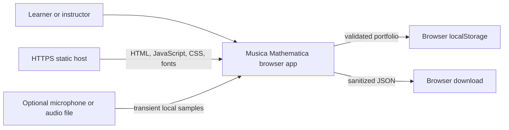
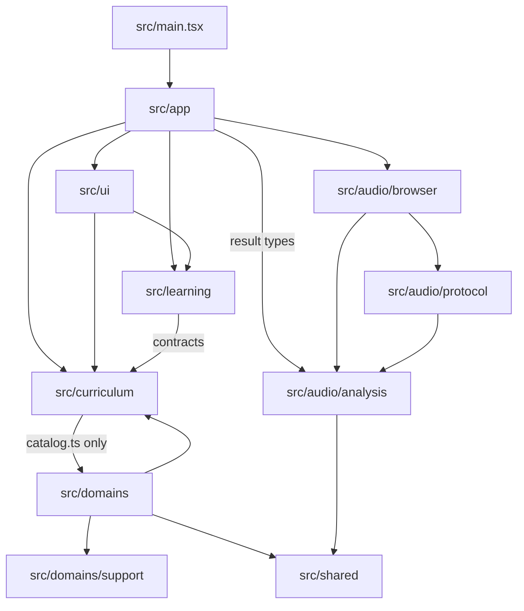
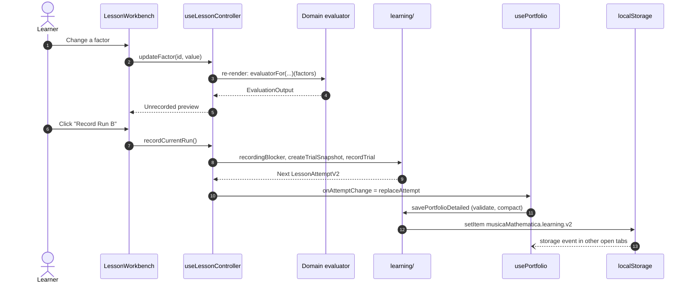
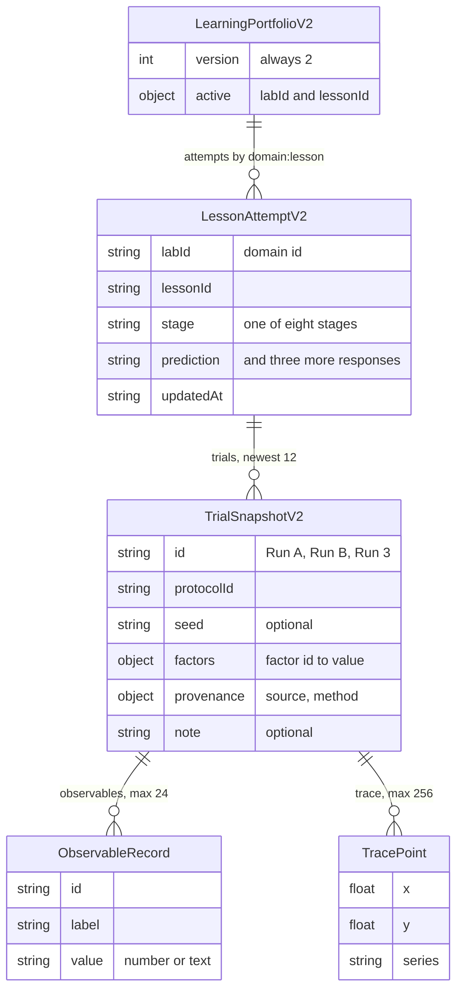
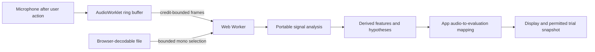
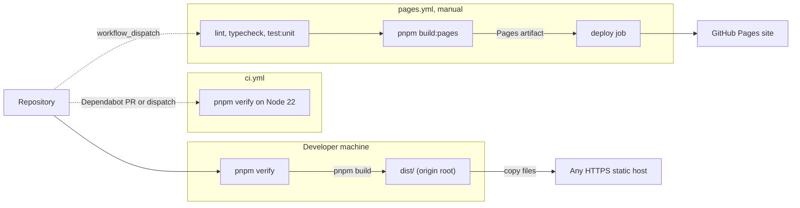

# Architecture

Musica Mathematica is a static React and Vite application. Lessons, learning
records, and optional audio analysis all run in the browser. The workers and
AudioWorklet are browser assets within the application bundle, not separate
services. The application has no server, accounts, database, remote storage,
analytics, or runtime API configuration.

## System context

The host serves the application files. Application code does not send portfolio
or audio data back to it. Portfolio export creates a local download, and the app
has no import or restore feature. The browser and operating system still control
media permissions and device access.

## Components and dependencies

An arrow means that the source may depend on the target. `eslint.config.mjs`
enforces these edges with layer import zones. Sibling-relative imports into
`audio/browser` are covered as well. The one edge from `src/curriculum/` to
`src/domains/` is `catalog.ts`, the composition root and the only importer of
domain modules. Domains import only the curriculum contracts and registry,
`domains/support`, `src/shared/`, and their own files, never the catalog.
Learning code imports curriculum contracts and registry ports but not the
catalog. `src/shared/` is a leaf and imports neither the curriculum nor any
application layer. `src/app/` reaches domain content only through the
curriculum registry and does not import `domains`. `src/ui/` does not import
`app`, `audio`, `domains`, or the catalog.

| Area | Responsibility |
| --- | --- |
| [`src/shared/numeric/`](../src/shared/numeric/) | Browser-independent numeric validation. |
| [`src/curriculum/`](../src/curriculum/) | `contracts.ts` (lesson, factor and evaluation contracts, audio-analysis policy helpers, `seedForTrial`), `registry.ts` (validation and `defineDomain`), `catalog.ts` (composition root), `evidence.ts` (claims and research sources), and `__golden__/evaluations.json`. |
| `src/domains/<id>/` | Eight deterministic domains, each with `lessons.ts`, `evaluators.ts`, `model.ts`, and `index.ts`. `ensemble-dynamics` also has `config.ts` and a test-only `model.reference.test-helper.ts`. |
| [`src/domains/support/`](../src/domains/support/) | `construction.ts` (definition builders) and `evaluation.ts` (`observable`, `result`, and `readNumber`, `readString`, `readBoolean`). |
| [`src/learning/`](../src/learning/) | `stages.ts` (ordered stages); `inquiry/comparison.ts` (controlled A/B rule) and `inquiry/recording.ts` (recording blockers, factors for an attempt); `portfolio/` with `schema.ts` (persisted version 2 types, `StoragePort`, keys, limits), `aggregate.ts`, `validate.ts`, `compact.ts`, `repository.ts`; and `portfolio/legacy/` (version 1 schema, validation, migration). |
| [`src/audio/analysis/`](../src/audio/analysis/) | Portable windowing, FFT-backed analysis, features, and ranked hypotheses. |
| [`src/audio/protocol/`](../src/audio/protocol/) | Worker and AudioWorklet messages and frame-sequence accounting. |
| [`src/audio/browser/`](../src/audio/browser/) | Media capture, file decoding, workers, AudioWorklet integration, and resource cleanup. |
| [`src/ui/`](../src/ui/) | Presentational React components driven by supplied state and callbacks. `format.ts` holds shared formatters and `workbench/types.ts` the runtime view contract. `audio/` holds the audio input controls. |
| [`src/app/`](../src/app/) | `App.tsx` (routing, focus, dialogs, layout); `portfolio/` (`usePortfolio.ts`, `browserStorage.ts`, `download.ts`); `routing/hashRoute.ts`; `workbench/` (lesson and playback controllers and `playbackStore.ts`); `audio/` (audio controllers and mapping of results to evaluations); and `demo/` (Pages-only seed and isolated storage). |

Domain logic, learning rules, and portable audio analysis do not use React, the
DOM, storage, Worker, AudioWorklet, or media APIs. Lint rejects a denylist of
browser globals, not every browser API, in these layers and in `src/ui/`, and it
rejects production imports of `*.test-helper` files. The legacy migration may
not import inquiry rules or curriculum evidence. `src/architecture.test.ts`
probes each import zone.

### Where new code goes

- A lesson goes in its domain's `lessons.ts`, with its evaluator in
  `evaluators.ts`, and the domain's `index.ts` registers both. A new domain is
  added through `src/curriculum/catalog.ts`. There is no central evaluator
  switch.
- Shared curriculum types and registry validation go in `src/curriculum/`.
  Generic numeric helpers go in `src/shared/`.
- Definition and evaluation helpers shared by domains go in
  `src/domains/support/`.
- Rendering goes in `src/ui/`. Stateful orchestration, routing, and browser
  adapters (storage, downloads, media) go in `src/app/` or
  `src/audio/browser/`.
- Tests are colocated as `*.test.ts(x)`. Shared test fixtures use the
  `*.test-helper.ts` suffix.

### Lesson policy lives in the curriculum

Lesson rules are data in the curriculum, not checks against lesson identifiers.
A factor may declare `audioSetting: "onsetSensitivity" | "meterBias"`. A lesson
with such factors supports controlled comparison of recorded audio, limited to
those factors, and those factors feed the audio analysis. The registry
validates the declarations. Claims and research sources come from
`src/curriculum/evidence.ts`, and the registry can check that every lesson
reference resolves. `seedForTrial` in `contracts.ts` derives a trial's random
seed from the lesson and its factors.

## Application and lesson flow

`index.html` loads `src/main.tsx`, which mounts `src/app/App.tsx` inside React
`StrictMode`. `App` resolves the hash route, selects the lesson, loads the
portfolio through an injected storage port, and composes the Lessons and My
learning dialogs with `LessonWorkbenchController`.

Lesson routes have the form `#/labs/<domain-id>/lessons/<lesson-id>`. When a
fragment does not identify a lesson, `App` replaces it with the current valid
route.

`LessonWorkbenchController` and `useLessonController` manage factor input,
evaluation, stage actions, playback, and optional audio requests. They pass a
view state to `src/ui/workbench/LessonWorkbench.tsx`. Numeric controls
can retain an invalid draft without passing it to a domain model, and native
form validation runs before a trial is recorded. A displayed audio observation
waits for current analysis instead of falling back to a synthetic result.

The workbench keeps an unrecorded preview separate from recorded evidence. A
learner must commit a prediction before experimenting, and comparison requires
two compatible trials. The ordered sequence of eight stages comes from
`src/learning/stages.ts`.

### What happens when a learner changes a factor and records a run

This is the central interaction. It shows which layer each click reaches.

Steps 2–5 run on every factor change: the new factors trigger a re-render, and
a `useMemo` calls the domain evaluator. That evaluator is a pure function looked
up through the registry, so the preview never touches storage.
At step 8, `recordingBlocker` refuses a run outside the experiment stage, or
an audio run without a fresh analysis. `recordTrial` then enforces the
12-trial cap. Saving (steps 11–12) is a React effect in `usePortfolio` that
runs whenever the portfolio object changes, not a call from the controller.
Step 13 is how a second tab learns about the write and reloads the record.

Where in the code:

- [src/ui/workbench/LessonWorkbench.tsx](../src/ui/workbench/LessonWorkbench.tsx): renders the controls and the preview.
- [src/app/workbench/useLessonController.ts](../src/app/workbench/useLessonController.ts): `updateFactor`, `recordCurrentRun`, and the other stage actions.
- [src/curriculum/registry.ts](../src/curriculum/registry.ts): `evaluatorFor`; evaluators live in `src/domains/<id>/evaluators.ts`.
- [src/learning/inquiry/recording.ts](../src/learning/inquiry/recording.ts) and [src/learning/portfolio/aggregate.ts](../src/learning/portfolio/aggregate.ts): recording rules and immutable attempt updates.
- [src/app/portfolio/usePortfolio.ts](../src/app/portfolio/usePortfolio.ts) and [src/learning/portfolio/repository.ts](../src/learning/portfolio/repository.ts): autosave, cross-tab reload, load, save, and export.

Playback advances with animation frames. Only the transport subscribes to
playhead updates, which are published at 10 Hz, with immediate notifications
when playback starts or stops. Stable memoized inputs keep playback from
recomputing unchanged charts, comparisons, and evidence. If lesson rendering
fails, its error boundary can retry with the default factors without discarding
saved attempts. `App` also manages focus after lesson and stage navigation;
native dialogs restore focus when dismissed with Escape.

`src/curriculum/catalog.ts` assembles the eight domains. The registry in
`src/curriculum/registry.ts` checks identifier uniqueness, exactly three lessons
per domain, evaluator coverage, factor definitions, and evaluator output. Each
domain maps its own lesson identifiers to evaluators.

## Portfolio state and privacy

`src/learning/portfolio/` defines the version 2 records and the code that
validates, sanitizes, aggregates, and stores them through `StoragePort`. The
production browser implementation is `src/app/portfolio/browserStorage.ts`.

The stored record is one JSON document per browser profile, with this shape:

Attempts are keyed by `attemptKey(labId, lessonId)`, so each lesson has at
most one attempt; restarting a lesson replaces it. `labId` is the historical
name for the domain identifier and stays for compatibility. A trial copies its
observables, trace and provenance from the `EvaluationOutput` it was recorded
from (`createTrialSnapshot`). The types are in
[src/learning/portfolio/schema.ts](../src/learning/portfolio/schema.ts) and
[src/curriculum/contracts.ts](../src/curriculum/contracts.ts).

The normal portfolio key is `musicaMathematica.learning.v2`. When no valid
version 2 record exists, the repository can copy one valid
`ensembleCouplingLab.learning.v1` record into the corresponding Ensemble
Dynamics lesson. It leaves the legacy record in place. The `labId` field name,
both storage keys, the migration behavior, and the exported fields are
compatibility contracts.

Validation and sanitization run when records are loaded, saved, and exported.
Each lesson keeps its newest 12 trials. A trial keeps at most 256
endpoint-sampled trace points, 16 factors with required lesson factors first,
and 24 observables. Responses and notes are limited to 16,384 Unicode code
points. Observable values and provenance methods are limited to 1,024 code
points, extension factor keys and values to 512, and display labels and trace
series names to 256. Canonical identifiers are preserved.

A compact serialized portfolio may contain at most 4 MiB of UTF-8 JSON. To meet
that limit, compaction first reduces traces, then removes the oldest trials that
are not needed for the comparison stage, and finally removes the oldest
non-active attempts. It retains the active attempt and the two trials required
at comparison and later stages. The UI reports compaction and storage failures.
If stored JSON is larger than 8 MiB, the app leaves the original value untouched,
disables automatic persistence, and displays recovery guidance. If a stored
version 2 record cannot be read, the repository first copies it to
`musicaMathematica.learning.v2.backup` and shows a notice before starting a
new portfolio; when that copy cannot be written and read back, it behaves as
for oversized data. The same one-slot copy is made before a load rewrites a
record, for example to drop attempts for lessons this build does not know; if
that copy cannot be kept and the rewrite would drop attempts, the original stays
untouched and automatic saving is turned off. An older version 1 record that
cannot be migrated is left in place and reported. An
unknown active lesson falls back to the default lesson instead of discarding
the other attempts. Clearing local work also removes the copy.

Each tab holds the portfolio in memory and saves the whole record. A tab
reloads the record when another tab writes one of the app's keys (the browser
`storage` event), keeping its own current lesson, so a later save does not
discard work saved in another tab. A reload never rewrites the record; it may
only take the backup copy, and a best-effort copy never replaces an existing
one. If a tab cannot read what another tab stored, it keeps its own work and
turns automatic saving off.

Portfolio records never contain raw audio, encoded files, file names, media
streams, object URLs, or device identifiers.

The GitHub Pages build injects the adapter in `src/app/demo/`. It creates a
schema-valid 90 to 120 BPM comparison with the production evaluator and stores
it under `musicaMathematica.demo.learning.v2`. The adapter hides both normal and
legacy keys. Reading, editing, or resetting the demo therefore cannot read,
migrate, overwrite, or clear a learner's normal portfolio.

## Local audio flow

A microphone capture lasts from 5 through 20 seconds. An audio file must have
an `audio/*` media type, occupy no more than 25 MiB, and decode to no more than
90 seconds. The selected range may be at most 30 seconds. Analysis uses frames
of 2,048 or 4,096 samples with 50% overlap. Credits on the worklet connection
prevent an unlimited backlog. The provenance dropped-frame total covers stale
frames and sequence gaps, while the expensive analysis stays off the UI thread.

Only Recorded-Onset Hypotheses can save an audio-derived controlled-comparison
snapshot. Chord Hypotheses and Time-Varying Timbre show audio results as an
additional observation; their controlled portfolio trials remain synthetic.
The [audio guide](LOCAL_AUDIO_METHOD.md) describes the algorithms, cleanup,
privacy rules, and limits on interpretation.

The mapped result reaches the lesson through `setAudioEvaluation` in
`useLessonController`. While the input mode is microphone or file, it replaces
the synthetic evaluation, and recording then follows the sequence above.

Where in the code:

- [src/app/audio/AudioInputController.tsx](../src/app/audio/AudioInputController.tsx) and [src/app/audio/audioInputAnalysis.ts](../src/app/audio/audioInputAnalysis.ts): `startMicrophoneAnalysis` and `analyzeFileSelection`, request gating, and cleanup.
- [src/audio/browser/fileInput.ts](../src/audio/browser/fileInput.ts): file checks and `decodeAudioSelection`.
- [src/audio/browser/worklets/captureProcessor.ts](../src/audio/browser/worklets/captureProcessor.ts): the AudioWorklet ring buffer.
- [src/audio/browser/workerClient.ts](../src/audio/browser/workerClient.ts) and [src/audio/browser/analysisWorker.ts](../src/audio/browser/analysisWorker.ts): both sides of the Web Worker connection.
- [src/audio/analysis/analysis.ts](../src/audio/analysis/analysis.ts): portable signal analysis and hypotheses.
- [src/app/audio/mapAudioEvaluation.ts](../src/app/audio/mapAudioEvaluation.ts): `selectionToEvaluation` and `microphoneFrameToEvaluation`.

## Builds and deployment

`pnpm build` runs `vite build` without a separate type-check, and writes an
origin-root bundle to `dist/`. `pnpm typecheck` covers the type-checking. `pnpm build:pages` runs Vite in `pages` mode, sets the base to
`/musica-mathematica/`, rewrites the favicon path, makes application, worker,
worklet, and font assets aware of that base, and enables isolated demo storage.

On Dependabot-authored pull requests or manual dispatch, CI installs the frozen
lockfile with Node 22 and runs `pnpm verify`. The GitHub Pages workflow is
manual and restricted to the default branch. It runs `pnpm lint`,
`pnpm typecheck` and `pnpm test:unit`, then builds, uploads and deploys the
Pages artifact. Neither workflow runs on ordinary pushes, so `pnpm verify`
before a change is the main gate. Only the
deploy job receives Pages and identity-token write permissions. Repository
settings, the live origin, response headers and cache behavior remain part of
the deployment environment.
`index.html` includes a same-origin meta Content Security Policy, with loopback
WebSocket access and inline styles for Vite development. Production builds
remove both (`vite.config.ts`). A deployed host should also send
appropriate security headers.

Where in the code: [vite.config.ts](../vite.config.ts) (both build modes),
[.github/workflows/ci.yml](../.github/workflows/ci.yml),
[.github/workflows/pages.yml](../.github/workflows/pages.yml), and
[src/main.tsx](../src/main.tsx), which switches to demo storage when
`vite.config.ts` defines `VITE_DEMO_MODE` as `true` for the Pages build.
[DEPLOYMENT.md](DEPLOYMENT.md) covers running the Pages workflow and forks.

## Stable contracts and extension points

Changes to the following values need focused tests and an explicit compatibility
or migration decision:

- route, domain, lesson, protocol, claim, factor, and input-mode identifiers;
- factor bounds, select options, and protocol identifiers, because stored
  trials whose values fall outside the current definitions are dropped on load
  (`src/curriculum/compatibility.test.ts` freezes them);
- `LessonDefinition`, `EvaluationOutput`, storage keys, portfolio version 2,
  trial and trace caps, export fields, and legacy migration behavior;
- audio frame sizes, input limits, queue capacity, and worker and AudioWorklet
  messages; and
- the origin-root and project-subpath asset assumptions of the two build modes.

See "Where new code goes" above for placement. New storage, media, or download
behavior belongs behind a port or browser adapter rather than in domain or
learning code.

## What local verification covers

Tests are colocated with the code they cover and run in Vitest's Node
environment. [CONTRIBUTING.md](../CONTRIBUTING.md) lists the commands and what
each runs. Golden files pin evaluator output
(`src/curriculum/__golden__/evaluations.json`, compared with a relative
tolerance of 1e-6 because floating-point results differ across platforms) and
the exported portfolio JSON (`src/learning/portfolio/golden-json.test.ts`). An
intentional model change regenerates the evaluator golden file, and that diff is
reviewed as a behavior change. The unit tests also check asset URLs in the Pages
build.

Local automated checks cannot establish browser permission behavior, microphone
hardware behavior, codec availability, applied media constraints, deployed
response headers, or the state of the live Pages site. The application also does
not provide accounts, remote storage, course authoring, LMS integration,
grading, calibrated measurement, complete transcription, or validated
assessment. [Scientific Basis](SCIENTIFIC_BASIS.md) explains how its outputs
should be interpreted.
